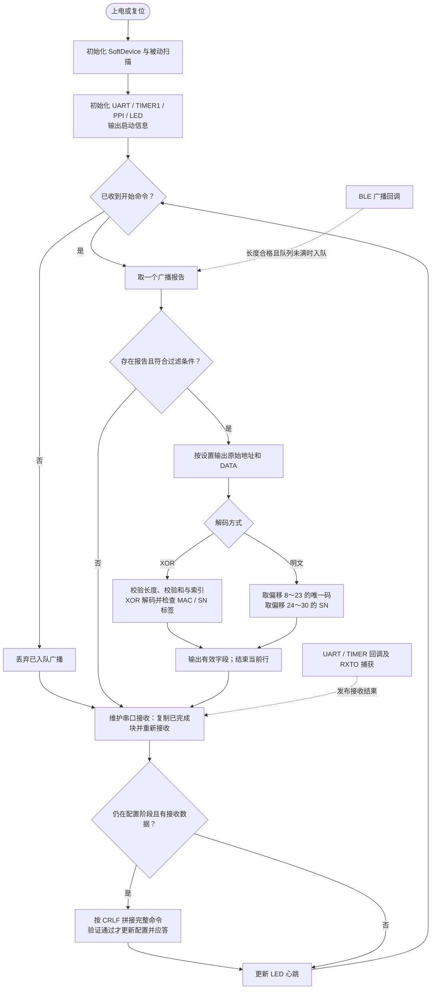

# 程序运行说明

## 先用一句话理解

这块板是一台“蓝牙广播接收器”：先由上位机通过串口设置筛选条件，再持续接收广播，留下符合条件的数据，解析其中的设备标识和 SN，最后通过串口输出。

## 从上电到输出

1. **初始化。** 先启用 SoftDevice 和 BLE，再初始化扫描器并开始被动扫描；随后初始化串口、定时器、PPI 和 LED，输出启动信息、命令列表及版本。
2. **等待配置。** 此时射频已经在扫描，但主循环丢弃收到的广播，不输出业务数据。串口收到完整的 `\r\n` 命令行后，检查参数、更新配置并回复。
3. **进入运行阶段。** `start_scanning` 或 `use_default_settings` 将程序切换到运行阶段。配置保存在 RAM 中，开始后不再接受修改；重新配置需要复位。
4. **逐条筛选。** 主循环每次从队列取一条广播。默认模式只检查 RSSI；自定义模式同时检查 RSSI 和广播数据开头的特征字节。
5. **解析并输出。** 可先显示原始地址和 DATA，然后按 XOR 或明文方式提取字段，输出 `DECRYPT_MAC`、`DECRYPT_SN`。不符合条件的报告直接跳过。
6. **持续循环。** 维护串口接收、更新 LED 心跳，继续处理下一条广播。

这里的“开始扫描命令”是历史命名，实际打开的是**广播过滤和输出**，不是首次启动射频。

## 实际参数

下表依据当前工程和代码，优先于旧的 `readme20260711.txt`。

| 项目 | 当前配置 |
|---|---|
| 芯片 | NRF52832 XXAA，512 KiB Flash、64 KiB RAM |
| SDK／协议栈 | 项目附带 nRF5 SDK 15.2.0 代码；S132 6.1.0 |
| BLE 模式 | 被动扫描、1 Mbps PHY，不自动连接、不去重 |
| 扫描间隔／窗口 | 均为 64 × 0.625 ms = **40 ms** |
| 扫描超时 | 0，持续扫描 |
| 广播最大处理长度 | 31 字节，超过则在入队前丢弃 |
| 广播队列 | 128 个槽位，实际可存 127 条；满时丢弃新报告 |
| UART | 115200，8N1，无 RTS／CTS 流控；TX=P0.06，RX=P0.08，上拉 |
| UART 接收缓冲／空闲超时 | 255 字节／2 ms；2 ms 用于结束本次 DMA 块，不等于命令行结束 |
| 命令行 | ASCII，必须以真正的 CRLF 两字节结束；可跨 DMA 块或同一块含多行 |
| RSSI | 可设 −105～0 dBm，默认模式未设置时用 −60 dBm |
| 初始解码模式 | XOR；`decoding_setting` 每发一次切换一次 |
| 原始数据显示 | 初始关闭；`mask_raw_data` 打开；默认启动方式也会打开 |
| LED | 主循环计数翻转 P0.04，周期受处理负载影响，不是固定时间 |
| 应用 Flash | 起始 `0x00026000`，容量 `0x0005A000` |
| 应用 RAM | 起始 `0x20002218`，容量 `0x0000DDE8` |

`1_user_project/sdk_config.h` 才是当前工程使用的配置文件，`0_readme/sdk_config.h` 是历史参考副本。

## 七条串口命令

下面的 `\r\n` 表示回车加换行，实际发送时应勾选 CRLF 或发送对应字节，而不是发送四个可见字符 `\`、`r`、`\`、`n`。

| 命令 | 功能 | 成功应答 |
|---|---|---|
| `rssi_set=-38\r\n` | 设置 RSSI 下限，接收 RSSI ≥ −38 的广播 | `[ rssi = -38 , rssi_set_ok ]` |
| `feature_value_set=020105\r\n` | 设置广播起始特征，1～31 字节纯十六进制，不带 `0x` 或空格 | `[ feature_value = 0x020105 ]` |
| `mask_raw_data\r\n` | 打开原始广播地址和 DATA 输出 | `[ mask_raw_data_ok ]` |
| `byte_order_set\r\n` | 反转原始广播地址的显示顺序 | `[ byte_order_set_ok ]` |
| `decoding_setting\r\n` | XOR／明文模式来回切换 | `[ plaintext_set_ok ]` 或 `[ cipnertext_set_ok ]` |
| `start_scanning\r\n` | 按自定义条件开始输出，随后锁定配置 | `[ start_scanning_ok ]` |
| `use_default_settings\r\n` | 忽略特征前缀，仅按 RSSI 开始输出，同时打开原始数据显示 | `[ default_settings_ok ]` |

`cipnertext` 的原有拼写特意保留，以兼容上位机。`mask_raw_data` 虽然名字像“屏蔽”，原程序实际行为是“打开”，本次仍保持该行为。

默认启动会保留已经成功设置的 RSSI、解码方式和地址显示顺序。若从未设置 RSSI，则用 −60。自定义启动仍要求事先设好 RSSI 和有效特征，否则不会有匹配输出。特征最多 31 字节，超过广播长度的设置会报错并保留原配置。

示例一：复位后，使用默认条件接收 XOR 编码广播。

```text
use_default_settings\r\n
```

示例二：复位后，接收 RSSI ≥ −38、特征为 `02 01 05` 的明文广播。

```text
rssi_set=-38\r\n
feature_value_set=020105\r\n
decoding_setting\r\n
mask_raw_data\r\n
start_scanning\r\n
```

建议上位机每发一条配置命令，收到应答再发下一条。驱动在停止 RX 与重新启动之间有短暂接收间隙，无硬件流控不能保证无限连续输入不丢字节。硬件接收出错时，会报错并丢弃到下一行末来恢复边界；必要时补发 CRLF 后重发命令。

## 两种广播解析方式

所有偏移均从 **0** 开始计数。这里沿用原协议的固定位置解析，不是通用 BLE TLV 解码器。

**XOR 模式：** 输入必须为 31 字节；第 8 字节是校验和，第 9 字节是码表起始索引，第 10～30 字节是 21 字节密文。

```text
校验：data[8] == (data[9] + ... + data[30]) 的低 8 位
索引：0～234；码表共有 255 个字节
解码：decoded[i] = data[10+i] XOR key[data[9]+i]，i=0～20
```

解码后，`decoded[0..1] = 04 06` 时，从 `decoded[2..7]` 取 6 字节 MAC；`decoded[8..9] = 05 07` 时，从 `decoded[10..16]` 取 7 字节 SN。两项独立判断，保留原行为。校验失败或索引越界就不输出解码字段。

**明文模式：** 输入同样必须为 31 字节，直接把 `data[8..23]` 的 16 字节作为设备唯一码，把 `data[24..30]` 的 7 字节作为 SN。输出标签仍叫 `DECRYPT_MAC`，但此时它是 16 字节唯一码，不是 BLE 的 6 字节地址。

`byte_order_set` 只影响原始广播地址 `[MAC=...]`，不会反转 `DECRYPT_MAC` 或 SN。XOR 码表、校验规则和字段偏移均保持不变；XOR 是原设备协议的编码方式，不具备密码学认证能力。

## 代码怎么读

| 文件 | 负责什么 | 建议关注的入口 |
|---|---|---|
| `1_user_project/main.c` | 初始化顺序、配置／运行阶段、LED 心跳 | `main()` |
| `8_hardware/app_config.h/.c` | 集中保存当前配置及其含义 | `app_config_t`、`g_app_config` |
| `8_hardware/uart_commands.c` | CRLF 分行、七条命令、参数验证、应答 | `uart_data_processing()`、`uart_commands_feed()` |
| `8_hardware/uarte_52832_dma.c` | EasyDMA 收发、接收完成和错误恢复 | `uart_dma_read()`、回调函数 |
| `8_hardware/timer.c`、`ppi.c` | 串口空闲检测和硬件停止确认 | `timer1_init()`、PPI 连接 |
| `8_hardware/ble_app.c` | 被动扫描、报告队列、格式化输出 | `main_loop_process()` |
| `8_hardware/adv_parser.c` | RSSI／特征筛选及固定字段提取 | `adv_matches()`、`adv_decode_fields()` |
| `8_hardware/data_processing.c` | 数值／十六进制转换、校验和、XOR | `feature_set()`、`decrypt_data()` |
| `8_hardware/my_printf.c` | 有界格式化、发送和有限等待 | `print()` |
| `8_hardware/led.c` | LED 引脚操作 | `led_init()`、`led_toggle()` |

`button`、`touch_pad`、`buzzer`、`gpiote` 是保留的开发板示例，当前主流程不调用。按键／触摸示例会等待释放，蜂鸣器接口会阻塞一段时间，不要直接加入持续采集的主循环。

`2_components`、`3_external`、`4_integration`、`5_modules` 和 `9_nrf52832_ble` 是 SDK／外部依赖，本次未批量改写。`7_softdevice_s132` 是协议栈镜像。`6_obj` 是旧 Keil 构建产物；`tests/build` 是本次测试产物。

## 为什么分开回调与主循环

BLE 回调只检查长度并把报告复制到队列，先写数据再发布写索引；主循环复制一条报告到局部变量后，就释放该槽位，然后慢慢打印。这样可以避免打印期间队列槽被并发复用，也让中断处理保持简短。

UART 每到一个字节，PPI 0／1 就清零并启动 TIMER1。2 ms 空闲、收满或出错时，请求异步停止 RX。nrfx 回调发布长度或错误标志；PPI 2 把硬件 `RXTO` 事件捕获到 TIMER1 CC1，确认接收真正停止。主循环复制数据并重启接收，然后才解析命令。

UART 和 TIMER1 中断同为优先级 6，避免两个回调相互嵌套改动接收状态。TIMER1 CC0 用于 2 ms 比较，CC1 用于停止确认；PPI 0／1／2 由本应用独占。以后增加外设时不要重复占用。

## 程序流程图

可直接打开 [独立 SVG 流程图](程序流程图.svg) 或 [PNG 图片](程序流程图.png)，也可以阅读下面的 Mermaid 版本。



筛选条件：默认模式为“RSSI 已配置且达到下限”；自定义模式还需“有效特征前缀匹配”。收到开始命令后的后续串口数据会被丢弃，配置不会再改变。
