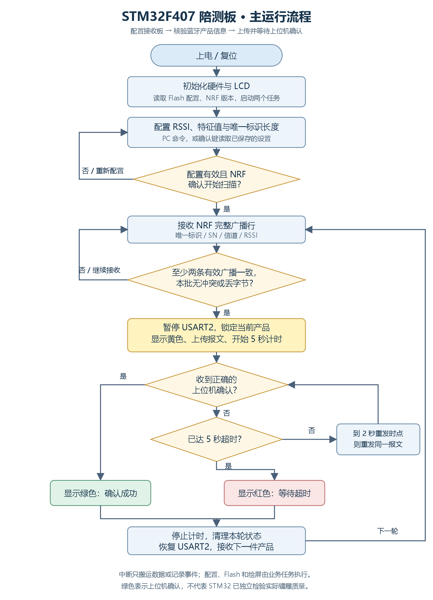
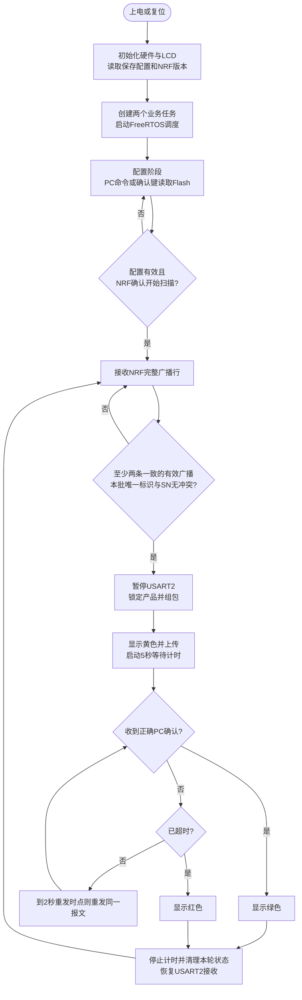
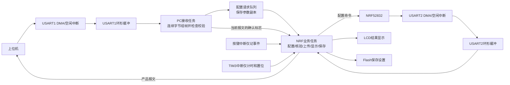

# 运行逻辑与流程图

## 一句话理解

**NRF52832 负责听蓝牙广播，STM32 负责配置它、核验收到的产品信息并交给上位机；上位机确认后，屏幕显示成功，再接收下一件产品。**

本工程本身不直接执行激光镭雕动作。它向上位机提供唯一标识、SN 和 RSSI；上位机如何驱动镭雕机属于另一套程序。

## 一次完整运行

1. **上电准备。** 初始化时钟、LCD、供电、串口、SPI Flash、按键和定时器。显示已保存的配置，读取 NRF52832 启动消息中的版本号，然后启动 FreeRTOS。
2. **设置筛选条件。** PC 从 USART1 设置 RSSI、6/7/8 字节特征值、唯一标识长度和项目名称；STM32 从 USART2 把相关命令交给 NRF52832。有效配置按原地址保存到外部 Flash。按确认键可以从 Flash 读取配置，按“RSSI → 特征值 → 长度/旧命令 → 开始扫描”的顺序使用。
3. **等待广播。** NRF52832 输出含唯一标识、SN、信道和 RSSI 的文本。STM32 按完整行收集，至少取得两条属于同一产品的有效广播；本批中有冲突、非法字段或丢字节，就不上传该批数据。
4. **上传并等待确认。** 暂停 USART2 接收，锁定当前产品；显示黄色，向上位机发送一份二进制结果报文。等待期间不会用另一个产品的数据替换当前报文。
5. **结束本轮。** 正确确认显示绿色；5 秒超时显示红色。等待期间约每 2 秒重发同一份报文，同一时段只重发一次。随后恢复 USART2，继续下一轮接收。

黄色表示“等待上位机确认”，绿色表示“收到上位机成功确认”，红色表示“等待超时”；绿色不等同于 STM32 已独立验证镭雕质量。

## 主流程图

下面是可直接查看的一张 PNG 图片：[打开原图](程序流程图.png)。另保留 [SVG 矢量版](程序流程图.svg)，便于无损缩放。

以下 Mermaid 源码供后续维护使用，需要支持 Mermaid 的阅读器才能渲染。

配置失败、损坏帧、超长文本、Flash/SPI 故障等异常均有边界检查，不作为有效产品上传。启动失败、FreeRTOS 断言失败或任务栈溢出时停机，需复位并检查调试信息。

## 两个任务与中断怎样配合

DMA 负责把串口数据搬入内存；空闲中断将数据交给环形缓冲。一次串口空闲只表示一段字节到达，**不保证正好是一条命令**。PC 任务因此持续组帧，支持一条命令分多次到达，也支持多条命令一起到达。

USART1 任务优先级为 6，USART2 任务优先级为 7，启动任务为 1。FreeRTOS tick 为 200 Hz，即每个 tick 5 ms。中断不绘屏、不写 Flash、不等待串口发送完成；串口缓冲读写使用保存/恢复中断状态的短保护区。

## 按键与模式

| 按键 | 引脚 | 用途 |
| --- | --- | --- |
| KEY1 | PB15 | 配置阶段发送 `decoding_setting`，切换明文/密文解析；以 NRF 返回确认更新显示 |
| KEY2 | PB14 | 配置阶段切换新/旧上位机命令规则 |
| KEY3 | PC7 | 确认使用 Flash 中保存的配置并开始扫描 |

默认使用新命令规则和密文解析。扫描开始后锁定相关配置，重启后重新进入配置阶段。旧规则把报文的 CMD 设置为单独保存的旧命令码；唯一标识的实际字节长度仍单独保存，不能把旧 CMD 当作数组长度。

## 维护时最需要知道的协议约定

| 内容 | 约定 |
| --- | --- |
| USART1 / USART2 | 均为 115200、8 数据位、无校验、1 停止位 |
| 文本命令 | 以 `\r\n` 结束；例如 `only_len_set=06\r\n`、`start_scanning\r\n` |
| RSSI 命令 | `7F 07 81 00 00 RSSI FCS`，有效范围 -105～0 |
| 特征值命令 | `7F LEN 82 00 00 FEATURE FCS`；FEATURE 为 6、7 或 8 字节 |
| 结果报文 | `7F LEN CMD 00 00 ID SN RSSI FCS`；SN 固定 7 字节，ID 为配置的 1～16 字节 |
| 成功确认 | `7F 07 CMD 80 00 00 FCS`；兼容历史文本 `tesk_ok\r\n`，保留原拼写 |
| 校验 | **从 LEN 开始，异或到 FCS 前一个字节；不包含 7F，也不包含 FCS 本身** |

根目录早期《上下位机沟通协议.txt》对校验范围的文字描述与实际源码不一致。本次保留实际代码和已有命令示例的算法，以避免破坏已部署上位机。例如 RSSI=-60 的指令仍为 `7F 07 81 00 00 C4 42`。

Flash 保持原有记录布局：RSSI 位于 `0x00`；特征字符串位于 `0x09`；项目名位于 `0x28`；新规则长度及 CRLF 位于 `0x46`；旧 CMD 及 CRLF 位于 `0x49`。修改格式或地址前必须考虑旧设备已保存的数据。

## 代码阅读顺序

先看 `main → ui_display_hardware_init → start_task`，再看 `usart1_receive_print_task` 和 `usart2_receive_print_task`。业务细节分别位于 `process_config_request`、`configure_from_flash`、`handle_nrf_line`、`start_report` 和 `process_report_result`。最后再阅读 DMA、环形缓冲和 Flash 驱动，避免初学时陷入寄存器细节。
